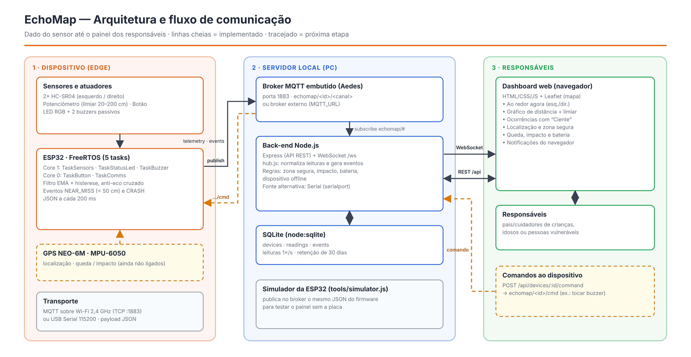

# EchoMap

**Dispositivo vestível com ESP32 que avisa os responsáveis quando uma criança, um idoso ou outra pessoa vulnerável chega perto demais de um obstáculo, sofre um impacto ou sai de uma zona segura.**

Projeto da disciplina **Sistemas Embarcados – CESAR School (2026.1)** · Grupo 19.



## O problema

Crianças com dificuldade de locomoção ou de percepção do ambiente, idosos e outras pessoas vulneráveis podem esbarrar em obstáculos, cair ou se afastar de um lugar seguro sem que ninguém perceba na hora. O EchoMap junta, num dispositivo pequeno preso ao corpo (pulseira, cinto ou colete):

- **percepção do entorno**: dois sensores ultrassônicos (esquerda e direita) e buzzers que apitam mais alto quanto mais perto está o obstáculo;
- **eventos para os responsáveis**: quase colisão, impacto/queda e pedido manual de ajuda, enviados via MQTT;
- **painel dos responsáveis**: distâncias em tempo real, histórico, ocorrências, localização e zonas seguras.

## Estrutura do repositório

| Pasta | Conteúdo |
|---|---|
| [`esp32-esp8266/`](esp32-esp8266/) | Firmware do nó principal (ESP32 + FreeRTOS, PlatformIO) |
| [`applications/`](applications/) | Back-end (Node.js, broker MQTT, SQLite) e dashboard web dos responsáveis |
| [`schematics/`](schematics/) | Diagrama de ligações e tabela de pinos |
| [`docs/`](docs/) | Arquitetura, contrato MQTT, protótipo do front-end, fotos dos componentes e relatórios |

## Como rodar

### 1. Dashboard e back-end (PC)

Requer Node.js 22.13 ou mais novo.

```bash
cd applications/dashboard
npm install
npm start                 # http://localhost:3000 · broker MQTT em :1883
```

Sem a placa, simule a ESP32 em outro terminal:

```bash
npm run simulate          # 2 ultrassônicos, igual ao firmware atual
npm run simulate:all      # + GPS, acelerômetro e bateria (sensores da próxima etapa)
```

### 2. Firmware (ESP32)

1. Instale a extensão **PlatformIO IDE** no VS Code e abra a pasta `esp32-esp8266/no-principal`.
2. Em `include/config.h`, ajuste Wi-Fi, IP do broker (o IP do PC que roda o dashboard) e `ENABLE_MQTT 1`.
3. **Build → Upload → Serial Monitor** (115200 baud).

Detalhes em [`esp32-esp8266/README.md`](esp32-esp8266/README.md).

## Status (checkpoint de 17/11/2026)

| Parte | Situação |
|---|---|
| Firmware: 2× HC-SR04, potenciômetro, botão, LED RGB, 2 buzzers, FreeRTOS (5 tasks) | implementado |
| Firmware: publicação MQTT | implementada (`ENABLE_MQTT`) |
| Back-end: broker embutido, API REST, WebSocket, SQLite, regras de alerta | funcionando (testado com o simulador) |
| Dashboard web em tempo real | funcionando (testado com o simulador) |
| GPS NEO-6M e acelerômetro MPU-6050 no firmware | próxima etapa |
| Comandos do painel para a placa (`echomap/<id>/cmd`) | back-end pronto, firmware pendente |

## Tecnologias

ESP32 · FreeRTOS · C++ (Arduino/PlatformIO) · MQTT (PubSubClient, Aedes) · Node.js · Express · WebSocket · SQLite · HTML/CSS/JS · Leaflet

## Equipe – Grupo 19

| Integrante |
|---|
| Amanda Montarroios |
| Bruno Assunção |
| Carlos Espósito |
| Fabiana Souza Leão |
| Felipe Marques |
| Jerônimo Barbosa (representante) |
| Mateus Ribeiro |

Professores: Bella Nunes e Jymmy Barreto.
