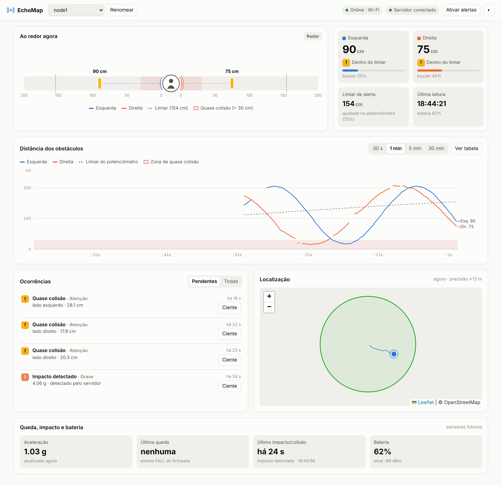

# Aplicações

| Pasta | O que é |
|---|---|
| [`dashboard/`](dashboard/) | Back-end Node.js (broker MQTT embutido, API REST, WebSocket, SQLite e regras de alerta) e dashboard web dos responsáveis |

O back-end e o front-end ficam no mesmo projeto: `dashboard/server/` é o back-end e `dashboard/public/` é o front-end (HTML/CSS/JS sem build).

```bash
cd applications/dashboard
npm install
npm start          # http://localhost:3000
npm run simulate   # em outro terminal, simula a ESP32
```

Documentação completa, contrato MQTT e API em [`dashboard/README.md`](dashboard/README.md).


