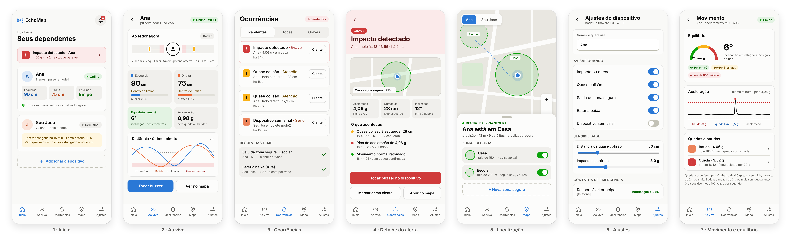
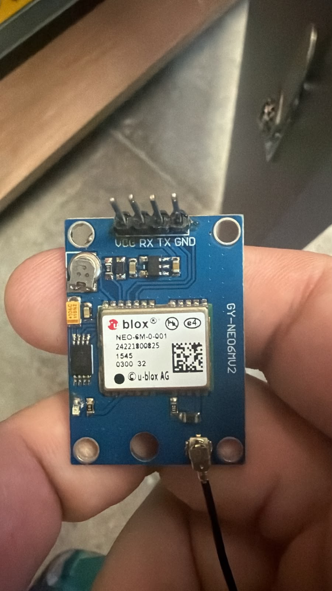
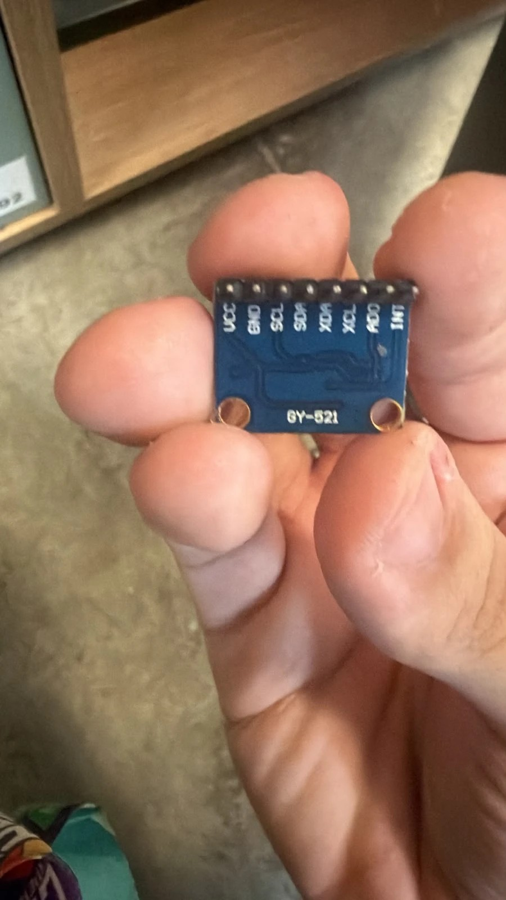

# Documentação – EchoMap

| Documento | Onde |
|---|---|
| Arquitetura e fluxo de comunicação | nesta página e [`img/arquitetura.svg`](img/arquitetura.svg) (gerada por [`img/gerar_arquitetura.py`](img/gerar_arquitetura.py)) |
| Contrato MQTT (tópicos e payloads) | nesta página |
| Protótipo do front-end (app dos responsáveis) | [`prototipo/`](prototipo/) |
| Fotos do GPS e do acelerômetro | [`componentes/`](componentes/) |
| Planejamento até a entrega final | [`planejamento.md`](planejamento.md) |
| Relatório do check point | [`checkpoint/`](checkpoint/) |
| Esquemático e tabela de pinos | [`../schematics/`](../schematics/) |
| Cases e suportes do colete (3D) | [`../hardware/cad/`](../hardware/cad/) |
| Foto da montagem na protoboard | [`img/montagem-protoboard.jpg`](img/montagem-protoboard.jpg) |

## Arquitetura

**Caminho do dado:**

1. A **ESP32** lê os dois HC-SR04 a cada 60 ms, sem disparar os dois ao mesmo tempo, para que o eco de um não chegue no outro. Ela filtra a leitura, aciona o LED RGB e o motor de vibração (MV50) de cada lado e calcula a velocidade de aproximação de cada lado e detecta `NEAR_MISS` só no risco crítico (impacto em até 1,5 s ou a menos de 25 cm), `CRASH` (clique longo no botão) e, com o MPU-6050, `FALL` e `IMPACT`, que esperam 5 s de pré-alerta: 1 clique no botão cancela e vira `DISMISSED`.
2. A cada 200 ms, a `TaskComms` monta um JSON e o envia pelos **dois canais**: **Serial** no cabo USB (o servidor acha a porta sozinho) e, com `ENABLE_MQTT 1`, **Wi-Fi/MQTT** em `echomap/node1/telemetry`. Os eventos vão para `echomap/node1/events`. Com os dois ligados, o servidor descarta as duplicatas.
3. No PC, o **back-end Node.js** se anuncia na rede (UDP 47801, a placa com servidor `auto` acha o IP sozinha), sobe um **broker MQTT embutido (Aedes)** na porta 1883 e assina `echomap/#`. O `hub.js` normaliza cada mensagem, aplica as regras (zona segura fixa e âncora rápida, local interno reconhecido pelo Wi-Fi, queda e impacto, dispositivo offline; a regra de bateria baixa já existe, mas a placa ainda não mede a bateria), monta o mapa de calor das quase colisões e grava em **SQLite** as leituras (no máximo 1 por segundo) e os eventos.
4. O **dashboard** recebe tudo em tempo real por **WebSocket** (`/ws`) e consulta o histórico pela **API REST** (`/api`). O responsável marca ocorrências como "ciente", recebe notificações do navegador e edita as zonas seguras no mapa. Fora do próprio computador, o painel pede uma senha.
5. O painel envia comandos com `POST /api/devices/:id/command` (vibrar para localizar, abrir o portal, trocar a rede Wi-Fi, testar os sensores, procurar o servidor). O back-end publica em `echomap/<id>/cmd` (só ele pode publicar nesse tópico) e também escreve pelo cabo USB, se a placa estiver nele.

## Contrato MQTT

Tópico: `echomap/<deviceId>/<canal>`, com payload JSON. O `deviceId` identifica cada pessoa ou dispositivo (`node1`, `node2`...).

| Tópico | Publisher | Subscriber | Payload (exemplo) | Situação |
|---|---|---|---|---|
| `echomap/node1/telemetry` | ESP32 | back-end | `{"t":5230,"mode":"RADAR","distL":87.2,"rawL":88.0,"distR":-1.0,"rawR":-1.0,"vibL":0.40,"vibR":0.00,"thr":120,"pot":0.55}` | implementado |
| `echomap/node1/events` | ESP32 | back-end | `{"event":"NEAR_MISS","side":"L","value":62.0,"reason":"ttc","ttc":0.8,"v":78,"t":6110}` · `{"event":"CRASH","t":9020}` · `{"event":"FALL","value":3.52,"unit":"g","t":7420}` · `{"event":"IMPACT","value":4.10,"unit":"g","t":9050}` · `{"event":"DISMISSED","cause":"FALL","value":3.52,"unit":"g","t":7420}` | implementado |
| `echomap/node1/location` | ESP32 (GPS) | back-end | `{"lat":-8.059280,"lon":-34.872030,"acc":6.5,"hdop":1.30,"sats":8,"speed":0.12,"t":6000}` | implementado |
| `echomap/node1/imu` | ESP32 (MPU-6050) | back-end | `{"ax":0.02,"ay":-0.01,"az":0.99,"gx":0.3,"gy":-0.2,"gz":0.1,"gMax":1.01,"tilt":4,"t":5230}` | implementado |
| `echomap/<id>/status` | ESP32 | back-end | `{"fw":"1.4.0","up":120,"rssi":-60,"ip":"192.168.1.7","ssid":"Casa","broker":"192.168.1.3:1883","auto":true,"mq":true,"q":0}` | implementado (bateria pendente) |
| `echomap/<id>/pong` | ESP32 | back-end | `{"pong":17,"t":6000}` | implementado (latência) |
| `echomap/<id>/diag` | ESP32 | back-end | `{"diag":{"L":{"trig":18,"echo":19,"echoOk":true,"cm":62.4},"R":{...}}}` | implementado (teste dos sensores) |
| `echomap/<id>/calib` | ESP32 | back-end | `{"calib":"running","elapsed":12,"duration":30,"steps":21}` · `{"calib":"done","type":"calibration_result",...}` | implementado (calibração assistida) |
| `echomap/<id>/wifi` | ESP32 | back-end | `{"type":"wifi_fingerprint","aps":[{"bssid":"EC:08:6B:12:34:56","rssi":-58,"ssid":"Casa"}],"t":...}` | implementado (local interno sem GPS) |
| `echomap/<id>/cmd` | back-end | ESP32 | `{"cmd":"locate"}` · `{"cmd":"portal"}` · `{"cmd":"wifi","ssid":"...","pass":"..."}` · `{"cmd":"server","host":"auto"}` · `{"cmd":"diag"}` · `{"cmd":"ping","id":17}` · `{"cmd":"haptic","pattern":"approach"}` · `{"cmd":"calibrate_start"}` · `{"cmd":"wifi_scan"}` | implementado |

A API só aceita esses comandos e valida os campos antes de mandar para a placa. Detalhes em [`applications/dashboard/README.md`](../applications/dashboard/README.md#api).

Eventos conhecidos pelo painel: `NEAR_MISS`, `CRASH`, `SOS`, `FALL`, `IMPACT`, `DISMISSED`, `GEOFENCE_EXIT/ENTER`, `ANCHOR_CREATED/REMOVED/EXPIRED/FAILED`, `LOW_BATTERY`, `DEVICE_OFFLINE/ONLINE`. Canais novos: `echomap/<id>/calib` (calibração) e `echomap/<id>/wifi` (assinatura de Wi-Fi sem GPS).

## Protótipo do front-end

Protótipo de média fidelidade do app dos responsáveis, com 7 telas clicáveis: Início, Ao vivo, Ocorrências, Detalhe do alerta, Localização/zonas seguras, Ajustes e Movimento e equilíbrio (acelerômetro: inclinação, aceleração e histórico de quedas e batidas). Ele segue a mesma linguagem visual do dashboard que já existe.

Link: https://claude.ai/artifact/XALGsWsSJYQuJyNCUk5RMF

## GPS e acelerômetro

| GPS u-blox NEO-6M (GY-NEO6MV2) | Acelerômetro/giroscópio MPU-6050 (GY-521) |
|---|---|
|  |  |
| Posição 1×/s para o mapa e as zonas seguras (UART2: GPIO 16/17) | Queda, batida e inclinação a 200 Hz (I²C: GPIO 26/27) |

Os dois já estão integrados no firmware. Detalhes da detecção em [`esp32-esp8266/README.md`](../esp32-esp8266/README.md#queda-impacto-e-equilíbrio-mpu-6050).

Os avisos no corpo saem por **dois módulos de vibração MV50** (firmware 2.0), com a linguagem háptica de 7 padrões (obstáculo parado, aproximação, aproximação rápida, pré-alerta, batimento, confirmação e localizar).
