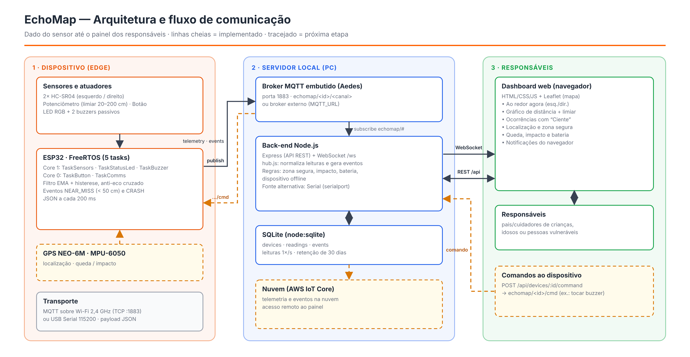
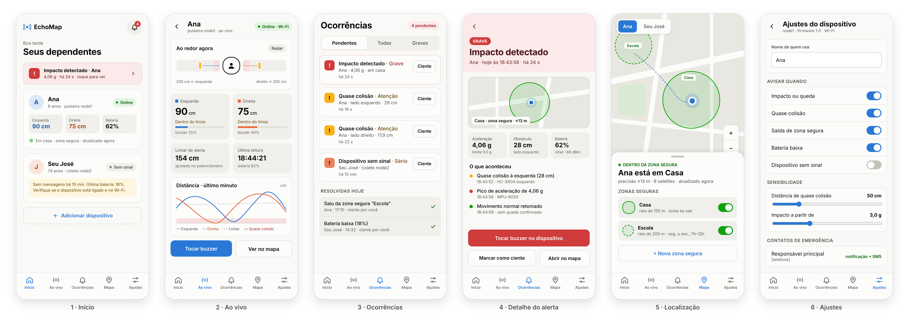

# Documentação – EchoMap

| Documento | Onde |
|---|---|
| Arquitetura e fluxo de comunicação | nesta página e [`img/arquitetura.svg`](img/arquitetura.svg) |
| Contrato MQTT (tópicos e payloads) | nesta página |
| Protótipo do front-end (app dos responsáveis) | [`prototipo/`](prototipo/) |
| Fotos dos componentes da próxima etapa | [`componentes/`](componentes/) |
| Planejamento até a entrega final | [`planejamento.md`](planejamento.md) |
| Relatório do check point | [`checkpoint/`](checkpoint/) |
| Esquemático e tabela de pinos | [`../schematics/`](../schematics/) |

## Arquitetura

**Caminho do dado:**

1. A **ESP32** lê os dois HC-SR04 a cada 60 ms, sem disparar os dois ao mesmo tempo, para que o eco de um não chegue no outro. Ela filtra a leitura, aciona o LED RGB e os buzzers e detecta os eventos `NEAR_MISS` (alguém a menos de 50 cm) e `CRASH` (clique longo no botão).
2. A cada 200 ms, a `TaskComms` monta um JSON e o envia pela **Serial** e, com `ENABLE_MQTT 1`, publica via **Wi-Fi/MQTT** em `echomap/node1/telemetry`. Os eventos vão para `echomap/node1/events`.
3. No PC, o **back-end Node.js** sobe um **broker MQTT embutido (Aedes)** na porta 1883 e assina `echomap/#`. O `hub.js` normaliza cada mensagem, aplica as regras (zona segura, impacto, bateria baixa, dispositivo offline) e grava em **SQLite** as leituras (no máximo 1 por segundo) e os eventos.
4. O **dashboard** recebe tudo em tempo real por **WebSocket** (`/ws`) e consulta o histórico pela **API REST** (`/api`). O responsável marca ocorrências como "ciente" e recebe notificações do navegador.
5. *Próxima etapa:* o painel envia comandos com `POST /api/devices/:id/command`. O back-end publica em `echomap/<id>/cmd` e o firmware, assinando esse tópico, aciona o buzzer.

## Contrato MQTT

Tópico: `echomap/<deviceId>/<canal>`, com payload JSON. O `deviceId` identifica cada pessoa ou dispositivo (`node1`, `node2`...).

| Tópico | Publisher | Subscriber | Payload (exemplo) | Situação |
|---|---|---|---|---|
| `echomap/node1/telemetry` | ESP32 | back-end | `{"t":5230,"mode":"RADAR","distL":87.2,"rawL":88.0,"distR":-1.0,"rawR":-1.0,"bzL":0.40,"bzR":0.00,"thr":120,"angle":0,"pot":0.55}` | implementado |
| `echomap/node1/events` | ESP32 | back-end | `{"event":"NEAR_MISS","side":"L","value":42.1,"t":6110}` · `{"event":"CRASH","t":9020}` | implementado |
| `echomap/<id>/location` | ESP32 (GPS) | back-end | `{"lat":-8.06,"lon":-34.87,"acc":8,"sats":9}` | back-end pronto, firmware pendente |
| `echomap/<id>/imu` | ESP32 (MPU-6050) | back-end | `{"ax":0.01,"ay":-0.02,"az":1.0}` (em g) | back-end pronto, firmware pendente |
| `echomap/<id>/status` | ESP32 | back-end | `{"battery":64,"rssi":-60,"fw":"1.0"}` | back-end pronto, firmware pendente |
| `echomap/<id>/cmd` | back-end | ESP32 | `{"cmd":"buzz","ms":3000}` | back-end pronto, firmware pendente |

O formato do `cmd` acima é uma sugestão: o back-end repassa para a placa o JSON que receber na API.

Eventos conhecidos pelo painel: `NEAR_MISS`, `CRASH`, `SOS`, `FALL`, `IMPACT`, `GEOFENCE_EXIT/ENTER`, `LOW_BATTERY`, `DEVICE_OFFLINE/ONLINE`.

## Protótipo do front-end

Protótipo de média fidelidade do app dos responsáveis, com 6 telas clicáveis: Início, Ao vivo, Ocorrências, Detalhe do alerta, Localização/zonas seguras e Ajustes. Ele segue a mesma linguagem visual do dashboard que já existe.

## Componentes da próxima etapa

| GPS u-blox NEO-6M (GY-NEO6MV2) | Acelerômetro/giroscópio MPU-6050 (GY-521) |
|---|---|
|  |  |
| Localização e zonas seguras (UART, 9600 baud) | Detecção de queda e impacto (I²C) |
