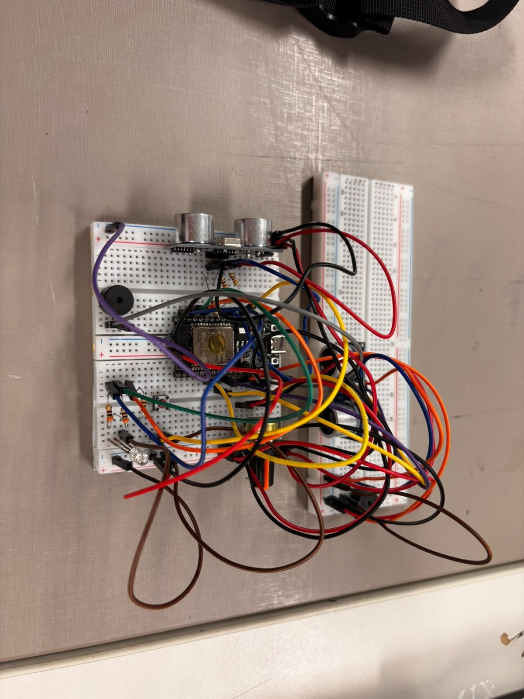

# Esquemático – nó principal

Diagrama de ligações gerado a partir de [`esp32-esp8266/no-principal/include/config.h`](../esp32-esp8266/no-principal/include/config.h). Mostra apenas o que está configurado no firmware atual.

- `diagrama-ligacoes.svg`: vetorial, para editar ou ampliar
- `diagrama-ligacoes.png`: imagem para relatórios

## Montagem na protoboard

## Tabela de pinos

| Componente | Pino do componente | ESP32 | Observação |
|---|---|---|---|
| HC-SR04 esquerdo | VCC / GND | VIN (5 V) / GND | |
| | TRIG | GPIO 18 | |
| | ECHO | GPIO 19 | divisor: ECHO → 1 kΩ → GPIO 19 → 2 kΩ → GND (5 V → 3,3 V) |
| HC-SR04 direito | VCC / GND | VIN (5 V) / GND | |
| | TRIG | GPIO 25 | |
| | ECHO | GPIO 33 | divisor 1 kΩ / 2 kΩ igual ao esquerdo |
| Potenciômetro | extremos / cursor | 3V3 e GND / GPIO 35 | entrada só-ADC |
| Botão | um lado / outro | GPIO 4 / GND | pull-up interno, interrupção na borda de descida |
| LED RGB (catodo comum) | R / G / B | GPIO 21 / 22 / 23 | 220–330 Ω em cada cor; comum no GND |
| Buzzer passivo esquerdo | + / – | GPIO 13 / GND | PWM (LEDC canal 0, 2 kHz) |
| Buzzer passivo direito | + / – | GPIO 14 / GND | PWM (LEDC canal 2, 2 kHz) |
| GPS NEO-6M (GY-NEO6MV2) | VCC / GND | 3V3 / GND | |
| | TX | GPIO 16 (RX2) | UART2 a 9600 baud |
| | RX | GPIO 17 (TX2) | opcional (só para configurar o módulo) |
| MPU-6050 (GY-521) | VCC / GND | 3V3 / GND | |
| | SDA / SCL | GPIO 26 / GPIO 27 | I²C a 400 kHz; os pinos padrão 21/22 estão com o LED RGB |
| | AD0 | GND | endereço 0x68 |

Todos os GND estão ligados ao mesmo terra. A ligação dos buzzers aparece de forma simplificada no diagrama.

**Próxima etapa:** os buzzers serão trocados por motores de vibração (alerta tátil). O circuito de acionamento e os pinos entram aqui quando forem definidos.
